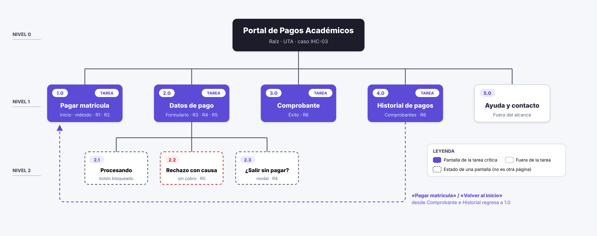
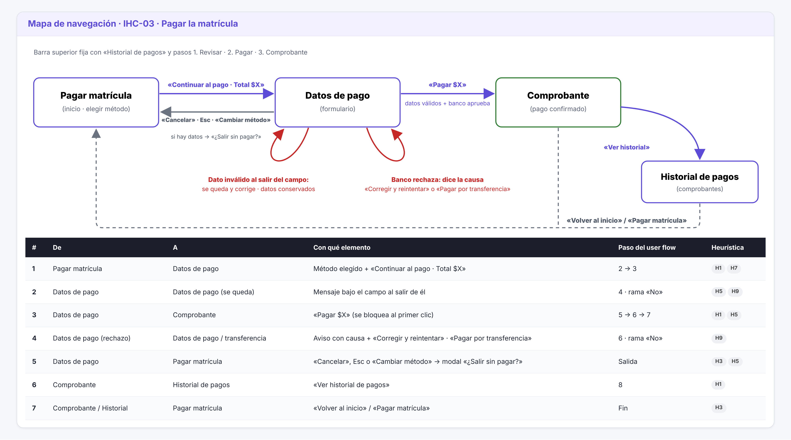
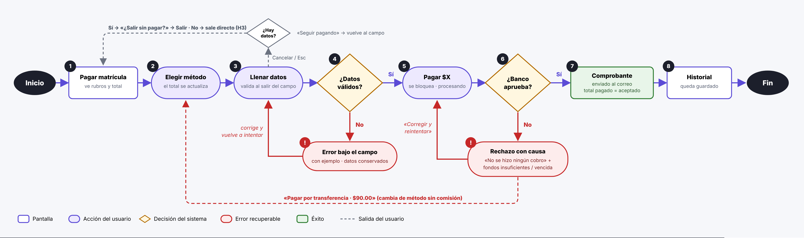

# Fase 2 · Arquitectura: sitemap, navegación y user flow · IHC-03

**Responsable:** Martín Palacios · Issue #12 «F2 · Reorganización, requisitos y arquitectura»
Base: G2 (`prototipos/02-sitemap.png`, `03-navegacion.md`, `04-user-flow.png`).

| Artefacto | Pregunta que responde |
|---|---|
| **Sitemap** | ¿Qué pantallas existen y de cuál cuelga cada una? |
| **Navegación** | ¿Con qué elemento se pasa de una pantalla a otra y adónde regresa el usuario? |
| **User flow** | ¿Qué camino sigue el usuario, dónde decide el sistema y cómo se recupera del error? |
| **Wireframe** | ¿Qué hay en cada pantalla y dónde? (ver [`wireframes/`](wireframes/)) |
| **Prototipo** | ¿Se puede usar de verdad? (ver [`prototipo/v1/`](prototipo/v1/)) |

## 1. Sitemap

- **Nivel 1:** 4 pantallas de la tarea (en morado): 1.0 Pagar matrícula, 2.0 Datos de pago, 3.0 Comprobante y 4.0 Historial de pagos. Más 5.0 Ayuda, que queda fuera del alcance.
- **Nivel 2:** 3 **estados** de «Datos de pago» (punteados, no son páginas nuevas): 2.1 Procesando, 2.2 Rechazo con causa y 2.3 ¿Salir sin pagar?
- **Cambio respecto a la v2 de la prueba:** el **Historial de pagos** pasa a ser parte de la tarea (P5) y el modal de salida es un estado nuevo (P2).

## 2. Navegación

**Adónde regresa el usuario:**
- Tras **pagar**: al Comprobante, y desde ahí al Historial o a Inicio.
- Tras **Cancelar / Esc**: si no escribió nada, a Inicio; si escribió algo, primero ve «¿Salir sin pagar?».
- Tras un **error**: se queda en Datos de pago, con el foco en el campo y sin perder lo escrito.

## 3. User flow

- **8 pasos** en el camino feliz: Pagar matrícula → Elegir método → Llenar datos → ¿Datos válidos? → Pagar → ¿Banco aprueba? → Comprobante → Historial.
- **Decisión 1 · ¿Datos válidos? → No:** error bajo el campo con un ejemplo; corrige y vuelve a intentar (R3, R5).
- **Decisión 2 · ¿Banco aprueba? → No:** rechazo con causa y «No se hizo ningún cobro»; «Corregir y reintentar» o «Pagar por transferencia · $90.00» (R5).
- **Salida · Cancelar / Esc → ¿Hay datos?** Sí → modal «¿Salir sin pagar?»; No → sale directo (R4).
- Así cumple las **2 ramas de flujo** con decisión y recuperación del error que pide la rúbrica.
