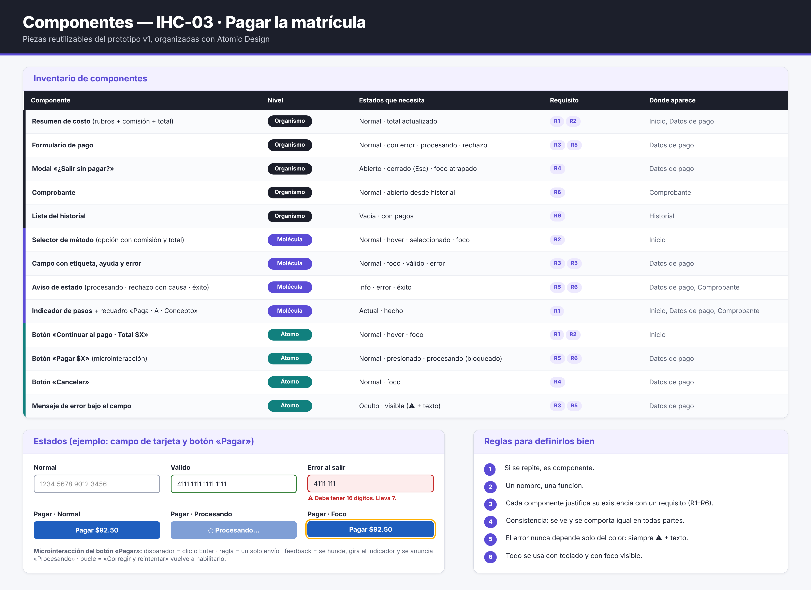

# Fase 2 · Inventario de componentes · IHC-03

**Responsable:** David (@DavidPe1307) · Issue «F2 · Componentes y formulario de pago»
Organizados con **Atomic Design** (átomo → molécula → organismo), (referencia conceptual: G2, no es una copia).

| Componente | Nivel | Estados | Requisito | Dónde aparece | Archivo del prototipo |
|---|---|---|---|---|---|
| Resumen de costo (rubros + comisión + total) | Organismo | normal · total actualizado | R1, R2 | Inicio, Datos de pago | `inicio.html`, `pago.html` |
| Formulario de pago | Organismo | normal · con error · procesando · rechazo | R3, R5 | Datos de pago | `pago.html` |
| Modal «¿Salir sin pagar?» | Organismo | abierto · cerrado (Esc) · foco atrapado | R4 | Datos de pago | `pago.html` |
| Comprobante | Organismo | normal · abierto desde el historial | R6 | Comprobante | `confirmacion.html` |
| Lista del historial | Organismo | vacía · con pagos | R6 | Historial | `historial.html` |
| Selector de método (opción con comisión y total) | Molécula | normal · hover · seleccionado · foco | R2 | Inicio | `inicio.html` |
| Campo con etiqueta, ayuda y error | Molécula | normal · foco · válido · error | R3, R5 | Datos de pago | `pago.html` |
| Aviso de estado (procesando · rechazo con causa · éxito) | Molécula | info · error · éxito | R5, R6 | Datos de pago, Comprobante | `pago.html`, `confirmacion.html` |
| Indicador de pasos + recuadro «Paga · A · Concepto» | Molécula | actual · hecho | R1 | Inicio, Datos de pago, Comprobante | todas |
| Botón «Continuar al pago · Total $X» | Átomo | normal · hover · foco | R1, R2 | Inicio | `inicio.html` |
| Botón «Pagar $X» | Átomo | normal · presionado · procesando (bloqueado) | R5, R6 | Datos de pago | `pago.html` |
| Botón «Cancelar» | Átomo | normal · foco | R4 | Datos de pago | `pago.html` |
| Mensaje de error bajo el campo | Átomo | oculto · visible (⚠ + texto) | R3, R5 | Datos de pago | `pago.html` |

## Microinteracción: botón «Pagar $X»
| Parte | Comportamiento |
|---|---|
| Disparador | Clic o Enter sobre «Pagar $X» |
| Reglas | Si hay errores, no envía y lleva el foco al primero; si no, envía **una sola vez** |
| Feedback | El botón se hunde, se bloquea con un indicador que gira («Procesando…») y el aviso se anuncia por lector de pantalla (`aria-live`) |
| Bucles y modos | Tras un rechazo vuelve a habilitarse; «Corregir y reintentar» lleva el foco al campo a revisar |

## Reglas
1. Si se repite, es componente. 2. Un nombre, una función. 3. Cada componente justifica su existencia con un requisito. 4. Se ve y se comporta igual en todas partes. 5. El error nunca depende solo del color: siempre ⚠ + texto. 6. Todo se usa con teclado y con foco visible.
