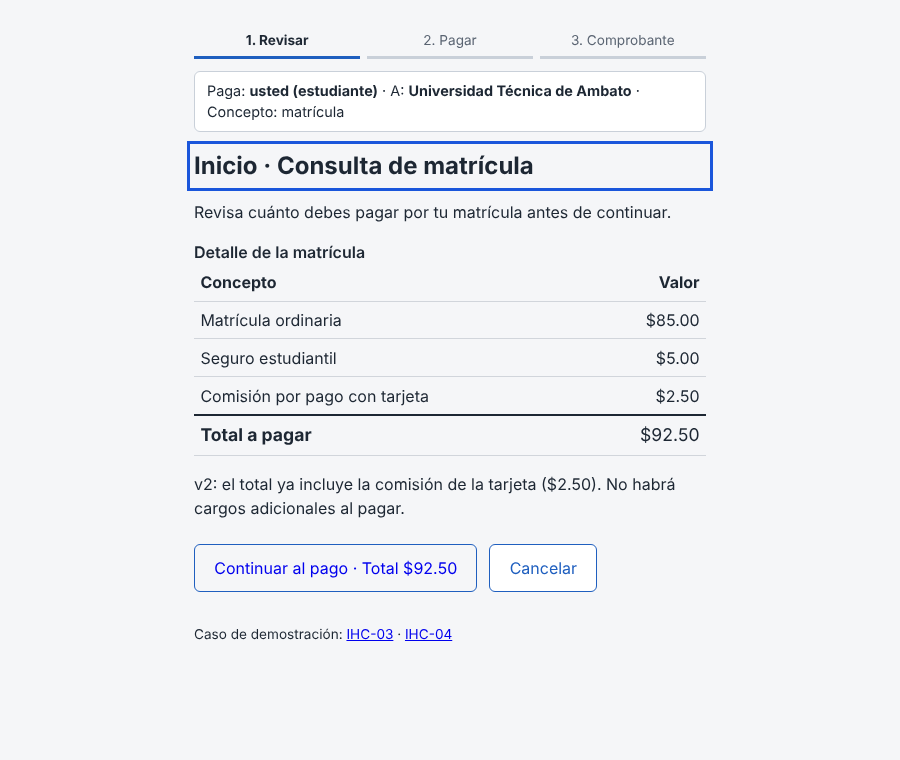
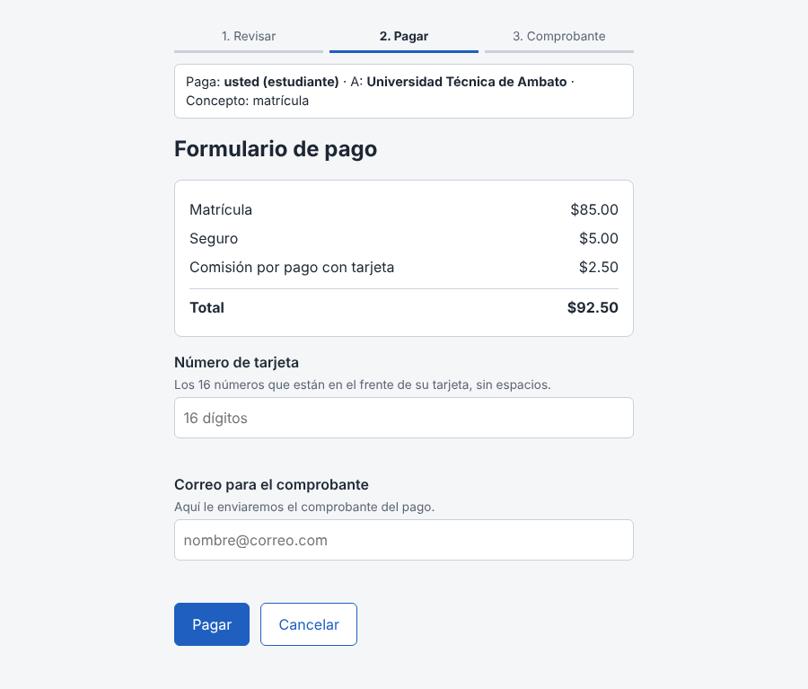
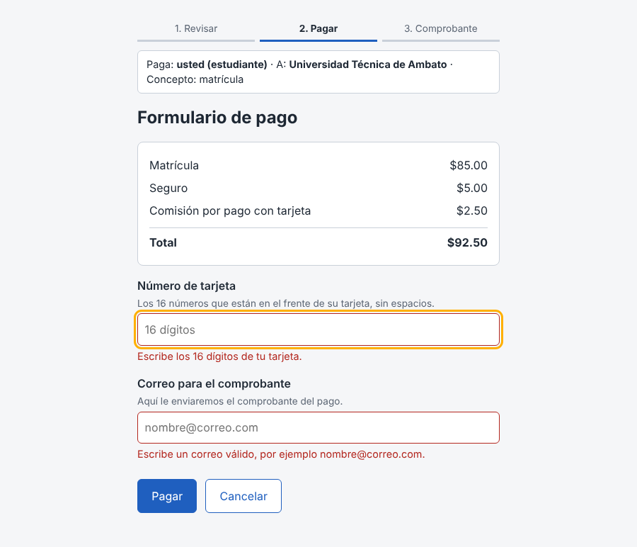
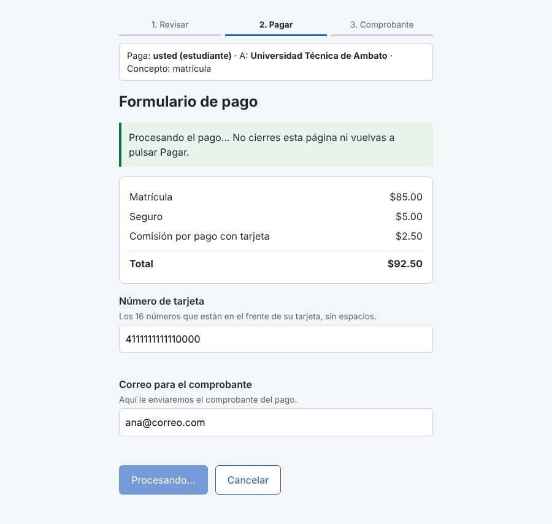
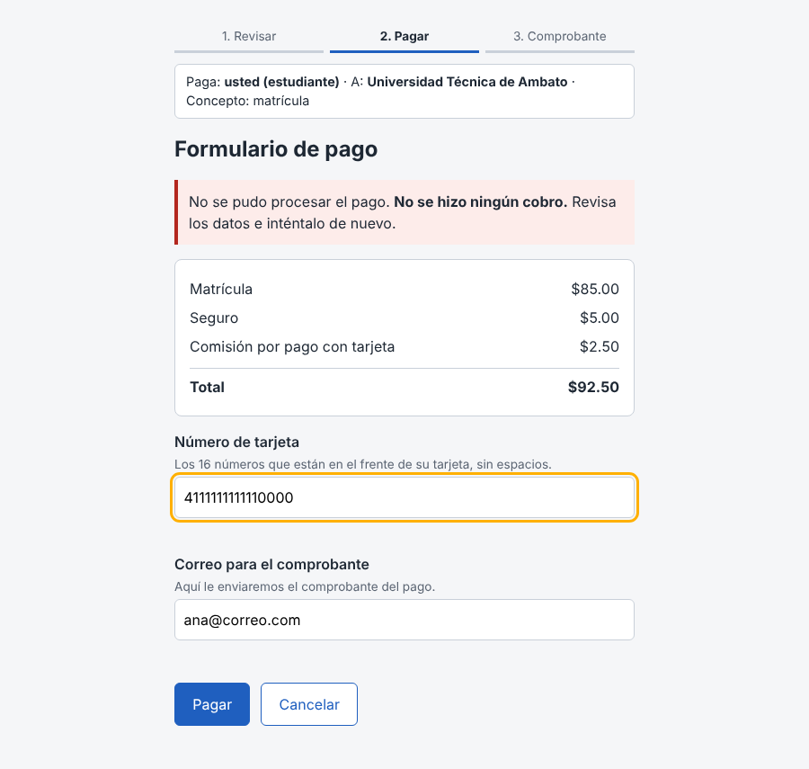
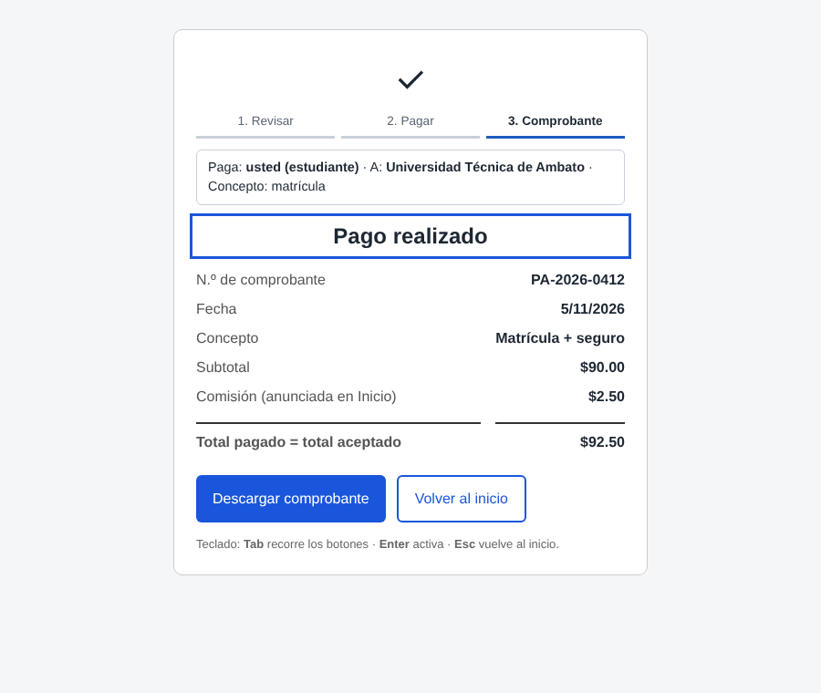
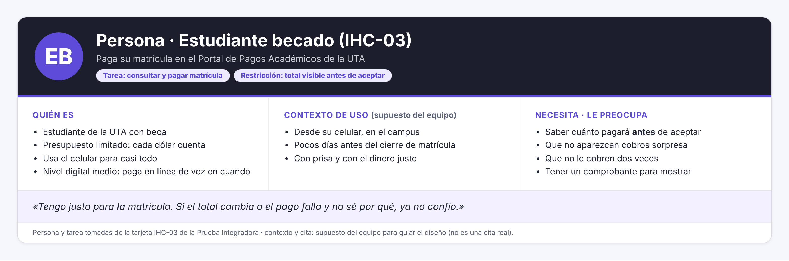
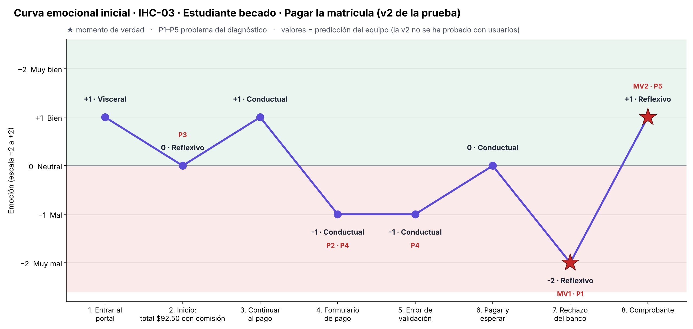

# Fase 1 · Diagnóstico UX · IHC-03 · Pagar la matrícula

**Grupo 2 · Paralelo B** · Interacción Humano–Computador · UTA · FISEI
**Base conceptual:** curva emocional, touchpoints y momentos de verdad ([G1 · HCI-2026-G1](https://github.com/juANO2202/HCI-2026-G1)) · heurísticas de Nielsen.

---

## 0. Punto de partida

Esta APE continúa la **Prueba Práctica Integradora** del grupo (caso *Pagos académicos*, variante B). De las dos tarjetas de esa prueba elegimos la **IHC-03 (estudiante becado)**.

La **interfaz que analizamos** es el **resultado de la prueba**: la versión corregida `prototipo/v2/` del repo de la prueba, que se abre con `inicio.html?caso=03`. Esa versión nunca se probó con usuarios, así que la APE empieza por diagnosticarla.

| Pantalla / estado de la v2 | Evidencia |
|---|---|
| Inicio · Consulta de matrícula |  |
| Formulario de pago |  |
| Error de validación |  |
| Procesando |  |
| Rechazo del banco |  |
| Comprobante |  |

---

## 1. Persona y contexto

| Campo | Dato | Origen |
|---|---|---|
| Persona | Estudiante becado con presupuesto limitado | Tarjeta IHC-03 |
| Tarea crítica | Consultar y pagar la matrícula | Tarjeta IHC-03 |
| Restricción | El costo total debe verse antes de aceptar | Tarjeta IHC-03 |
| Fallo de origen | Comisión inesperada al final ($90.00 → $92.50). Ya corregido en la v2 | Tarjeta IHC-03 |
| Contexto de uso | Desde su celular, en el campus, pocos días antes del cierre de matrícula, con prisa y con el dinero justo | Supuesto del equipo |

---

## 2. Tareas T1–T3

Estas tres tareas se usan en la Fase 3 con P01 y P02.

| Tarea | Lo que se le dice al participante | Criterio de éxito |
|---|---|---|
| **T1 Localizar** | «Quiere pagar su matrícula. Averigüe cuánto va a pagar en total y llegue a donde se paga.» | Dice el total ($92.50) y llega al formulario de pago sin ayuda |
| **T2 Operar / corregir** | «Pague con la tarjeta 4111 1111 1111 1111 y su correo. Si algo sale mal, corríjalo.» | Llena los campos y corrige el error que aparezca sin perder lo escrito |
| **T3 Finalizar / confirmar** | «Termine el pago y dígame cómo sabe que quedó hecho y cuánto pagó.» | Llega al comprobante y dice el monto pagado ($92.50) |

---

## 3. Touchpoints y curva emocional inicial

**Escala:** −2 muy mal · −1 mal · 0 neutral · +1 bien · +2 muy bien.
**Nivel emocional (Norman):** visceral = primera impresión · conductual = mientras lo usa · reflexivo = lo que piensa después.
**Datos:** [`recorrido-emocional.csv`](recorrido-emocional.csv).

| N.º | Touchpoint | Qué hace el usuario | Emoción | Por qué | Nivel | ¿Momento de verdad? | Problema |
|---|---|---|---|---|---|---|---|
| 1 | Entrar al portal | Abre el portal desde el celular | +1 | Se ve ordenado y muestra los pasos 1-2-3 | Visceral | No | — |
| 2 | Inicio: total $92.50 con comisión | Revisa cuánto debe pagar | 0 | Sabe el total antes de aceptar, pero paga $2.50 de comisión sin otra opción | Reflexivo | No | P3 |
| 3 | Continuar al pago | Pulsa «Continuar al pago · Total $92.50» | +1 | El botón repite el total y no hay sorpresas | Conductual | No | — |
| 4 | Formulario de pago | Escribe la tarjeta y el correo | −1 | La tarjeta se escribe «sin espacios» y es difícil revisarla; Esc o Cancelar borran todo sin avisar | Conductual | No | P2 · P4 |
| 5 | Error de validación | Pulsa Pagar y ve errores | −1 | Se entera del error recién al final, no al salir del campo | Conductual | No | P4 |
| 6 | Pagar y esperar | Espera mientras procesa | 0 | El botón bloqueado y el aviso lo tranquilizan | Conductual | No | — |
| 7 | Rechazo del banco | Lee que el pago no se procesó | **−2** | No sabe la causa ni qué dato cambiar; solo sabe que no le cobraron | Reflexivo | **Sí · MV1** | P1 |
| 8 | Comprobante | Lee el comprobante | +1 | El total pagado es el aceptado, pero no le confirman el envío al correo ni queda en un historial | Reflexivo | **Sí · MV2** | P5 |

---

## 4. Momentos de verdad

1. **MV1 · Rechazo del banco (touchpoint 7, −2).** Es el punto más bajo de la curva. El becado tiene el dinero justo y el sistema le dice que el pago no se procesó sin decirle por qué. Aquí decide si vuelve a intentar, cambia de tarjeta o abandona y va a ventanilla. **Es el que más afecta la confianza.**
2. **MV2 · Comprobante (touchpoint 8, +1).** Por la regla pico-final, el usuario recuerda sobre todo el final de la experiencia. El comprobante confirma que pagó el total aceptado (eso ya funciona), pero no confirma el envío al correo ni deja el comprobante en un historial. El cierre queda en +1 cuando podría llegar a +2.

---

## 5. Problemas priorizados

Severidad de Nielsen: 1 cosmético · 2 menor · 3 mayor · 4 catastrófico.
Tipo de fallo según la guía: navegación · confianza · retroalimentación.

| # | Problema | Dónde (evidencia) | Tipo | Heurística | Sev. | Issue |
|---|---|---|---|---|---|---|
| **P1** | Si el banco rechaza el pago, el mensaje no dice **la causa** (fondos insuficientes, tarjeta vencida…) ni **qué dato** revisar. Solo dice «Revisa los datos e inténtalo de nuevo» | Touchpoint 7 · [`v2-05-rechazo-banco.png`](evidencias/v2-05-rechazo-banco.png) | Retroalimentación | **H9** Ayudar a reconocer, diagnosticar y recuperarse de errores | **3** | #__ |
| **P2** | «Cancelar» y la tecla **Esc** sacan del formulario **sin preguntar**, y se pierde lo escrito | Touchpoint 4 · comprobado: con la tarjeta a medio escribir, Esc lleva directo a Inicio | Navegación | **H3** Control y libertad del usuario · H5 | **3** | #__ |
| **P3** | Solo hay **un método de pago (tarjeta, con comisión de $2.50)**. El becado no puede comparar ni elegir una opción sin comisión | Touchpoint 2 · [`v2-01-inicio.png`](evidencias/v2-01-inicio.png) | Confianza | **H7** Flexibilidad y eficiencia de uso · H5 | **3** | #__ |
| **P4** | Los errores aparecen **solo al pulsar «Pagar»**, no al salir de cada campo, y la tarjeta se pide «sin espacios», lo que la hace difícil de revisar | Touchpoints 4 y 5 · [`v2-03-error-validacion.png`](evidencias/v2-03-error-validacion.png) | Retroalimentación | **H5** Prevención de errores | **2** | #__ |
| **P5** | Se pide el correo «para enviarle el comprobante», pero el comprobante **no confirma que se envió**, se descarga como `.txt` y no queda en un historial | Touchpoint 8 · [`v2-06-comprobante.png`](evidencias/v2-06-comprobante.png) | Confianza | **H1** Visibilidad del estado del sistema | **2** | #__ |

**Heurísticas distintas:** H1, H3, H5, H7 y H9.

**Por qué este orden:** P1 y P2 pueden costarle al usuario dinero o trabajo, porque no sabe por qué falló el pago o pierde lo que escribió. P3 toca la confianza de alguien con presupuesto limitado. P4 y P5 retrasan o dejan dudas, pero no impiden terminar la tarea.

---

## 6. Dato medido vs. predicción del equipo

| Dato | Tipo | Fuente |
|---|---|---|
| P1 terminó la tarea de IHC-03 **con ayuda**, en ≈ 5 min | **Medido** sobre la **v1** | Prueba integradora · `pruebas/sesion.md` · 29/10/2026 |
| P1 no supo para qué era cada campo ni cómo llenarlo | **Medido** sobre la v1 | Ídem |
| P1 no notó la comisión ni el cambio del total | **Medido** sobre la v1 | Ídem |
| P1 pidió «que se vieran los pasos, quién paga y a qué entidad» | **Medido** sobre la v1 | Ídem |
| Los 5 problemas de la v2 y su severidad | **Predicción** (inspección heurística del equipo) | Este documento |
| Las emociones de la curva inicial | **Predicción** del equipo | Este documento |

**Relación con lo medido:** P4 continúa lo observado con P1, que no supo llenar los campos. La v2 agregó textos de ayuda, pero sigue validando solo al final. Los demás problemas son nuevos y salen de la inspección de la v2. Se confirmarán o se descartarán con P01 y P02 en la Fase 3.

---

## 7. Qué pasa a la Fase 2

- **R1–R6** saldrán de la tarea crítica y de los problemas P1–P5.
- El rediseño tiene que **subir los dos momentos de verdad**: MV1 de −2 a 0 o más, y MV2 de +1 a +2.
