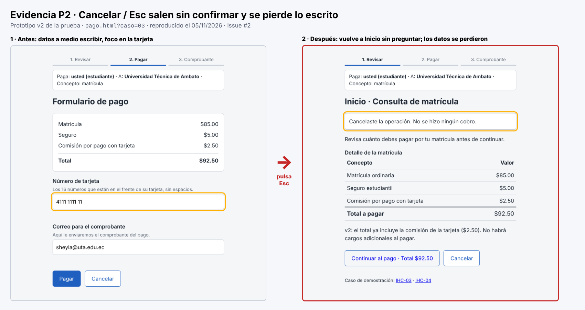
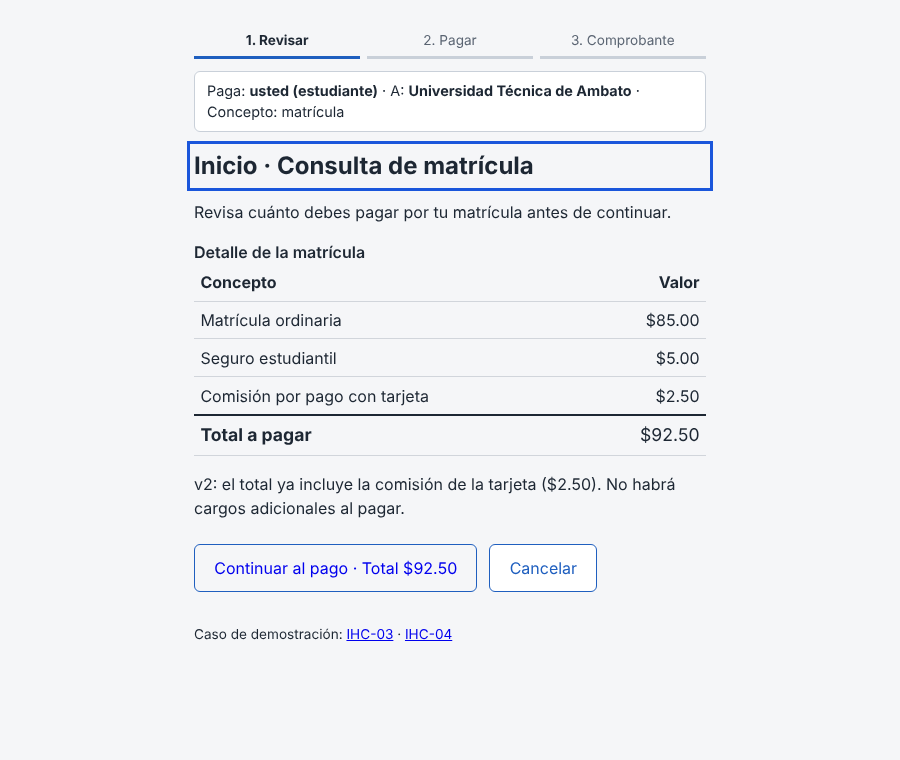
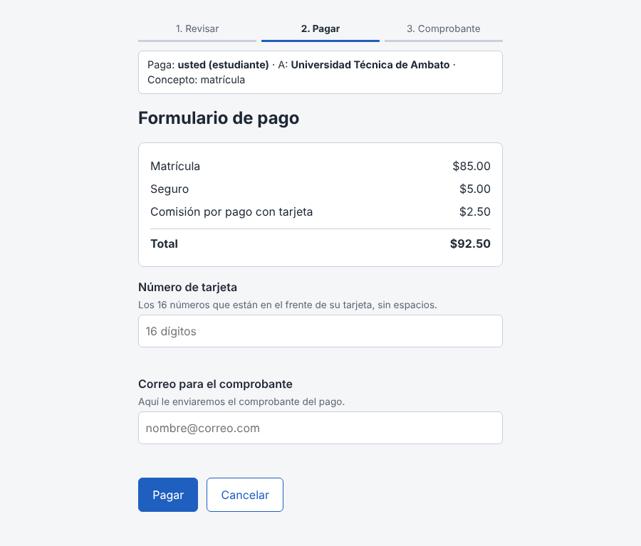
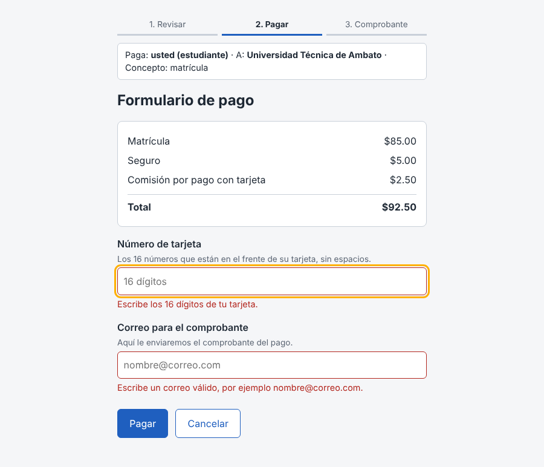

# Fase 1 · Evidencia de los problemas P2, P3 y P4

**Responsable:** Sheyla Pacha (@Zzzheyla) · Issues **#2**, **#3** y **#4**
**Interfaz analizada:** `prototipo/v2/` de la Prueba Integradora (resultado de la prueba), caso **IHC-03 · estudiante becado · pagar la matrícula**.
**Tipo de dato:** inspección heurística del equipo (predicción). La v2 no se ha probado con usuarios; P01 y P02 lo confirmarán o lo descartarán en la Fase 3.

Severidad de Nielsen: 1 cosmético · 2 menor · 3 mayor · 4 catastrófico.
Escala emocional: −2 muy mal · −1 mal · 0 neutral · +1 bien · +2 muy bien.

---

## P2 · «Cancelar» y Esc salen del formulario sin confirmar y se pierde lo escrito · Issue #2

| Campo | Dato |
|---|---|
| Touchpoint | Formulario de pago |
| ¿Momento de verdad? | No |
| Emoción esperada | −1 · conductual |
| Tipo de fallo (guía, sección 3) | Navegación |
| Heurística | **H3** Control y libertad del usuario · H5 Prevención de errores |
| Severidad | **3** (mayor) |

**Cómo se reproduce:**
1. Abrir `prototipo/v2/pago.html?caso=03`.
2. Escribir parte de la tarjeta y el correo.
3. Pulsar **Esc** (o el botón «Cancelar»).
4. **Resultado:** vuelve a Inicio de inmediato, sin preguntar. Los datos escritos se pierden.

**Por qué importa:** Esc es una tecla que se pulsa sin querer, por ejemplo para cerrar el teclado del celular o un autocompletado. El becado tiene prisa por el cierre de matrícula y tiene que volver a escribir todo.
**Mejora propuesta:** si hay datos escritos, preguntar «¿Salir sin pagar? Se perderá lo que escribió», con las opciones «Seguir pagando» y «Salir sin pagar».

---

## P3 · Solo hay un método de pago con comisión: el becado no puede elegir · Issue #3

| Campo | Dato |
|---|---|
| Touchpoint | Inicio: ver total $92.50 con comisión |
| ¿Momento de verdad? | No |
| Emoción esperada | 0 · reflexivo |
| Tipo de fallo (guía, sección 3) | Confianza |
| Heurística | **H7** Flexibilidad y eficiencia de uso · H5 Prevención de errores |
| Severidad | **3** (mayor) |

**Evidencia:** en Inicio solo aparece «Comisión por pago con tarjeta $2.50». No hay otra forma de pago ni manera de comparar.

**Por qué importa:** la persona tiene un presupuesto limitado. La v2 ya cumple la restricción de mostrar el total antes de aceptar, pero obliga a pagar $2.50 sin alternativa. Ve el costo, pero no tiene control sobre él.
**Mejora propuesta:** un selector de método de pago que muestre la comisión de cada uno (tarjeta $2.50 · transferencia $0.00) y actualice el total **antes** de continuar.

---

## P4 · Los errores aparecen solo al pulsar «Pagar» y la tarjeta se escribe sin espacios · Issue #4

| Campo | Dato |
|---|---|
| Touchpoint | Formulario de pago · Error de validación |
| ¿Momento de verdad? | No |
| Emoción esperada | −1 · conductual |
| Tipo de fallo (guía, sección 3) | Retroalimentación |
| Heurística | **H5** Prevención de errores |
| Severidad | **2** (menor) |

**Evidencia 1:** la ayuda pide la tarjeta «sin espacios», así que 16 números seguidos son difíciles de revisar.

**Evidencia 2:** los mensajes de error aparecen recién al pulsar «Pagar», todos a la vez, y no al salir de cada campo.

**Relación con un dato medido:** en la sesión de la prueba (29/10/2026, sobre la v1), **P1 no supo para qué era cada campo ni cómo llenarlo** y necesitó ayuda (`pruebas/sesion.md` del repo de la prueba). La v2 agregó textos de ayuda, pero sigue validando solo al final.
**Mejora propuesta:** validar cada campo al salir de él, agrupar la tarjeta de 4 en 4 (4111 1111 1111 1111) y mostrar un ejemplo en cada mensaje de error.
