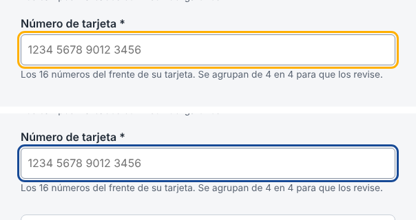
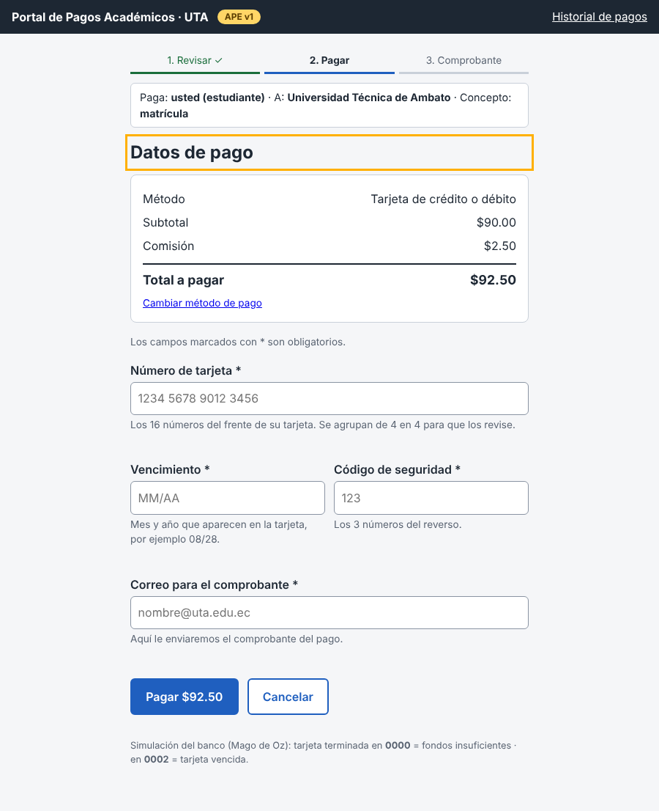
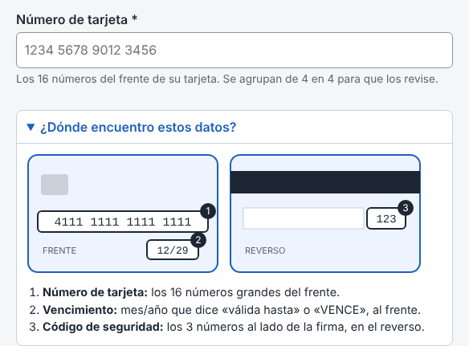
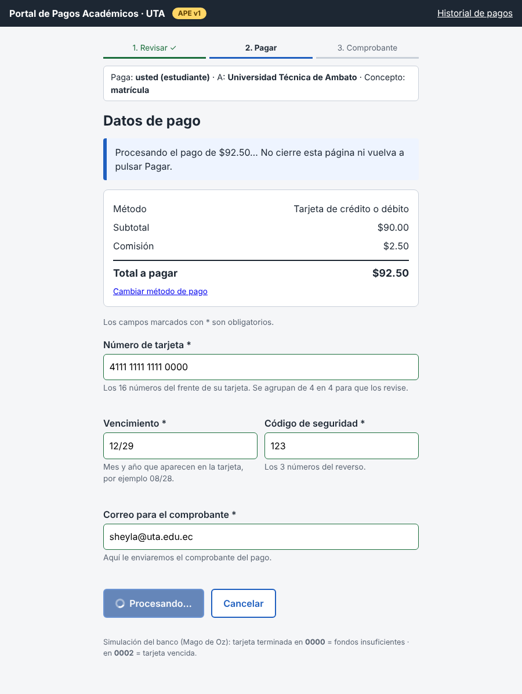
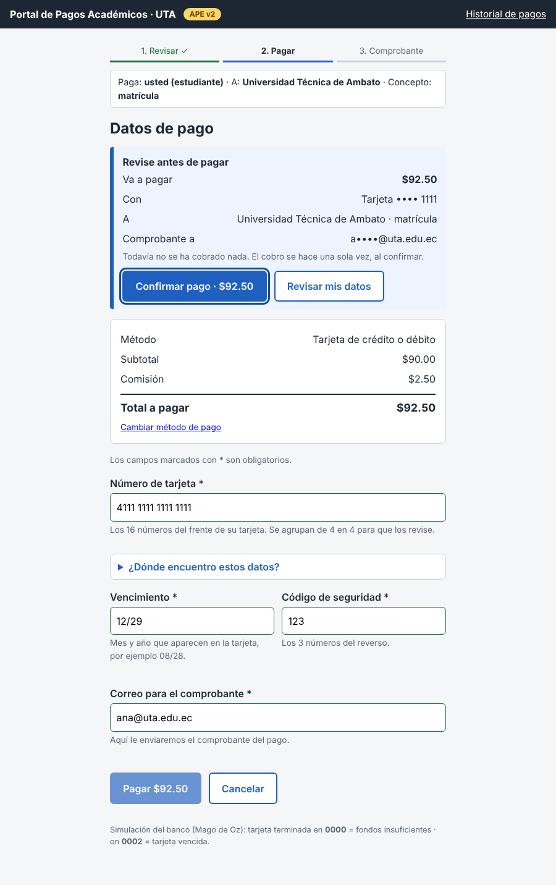
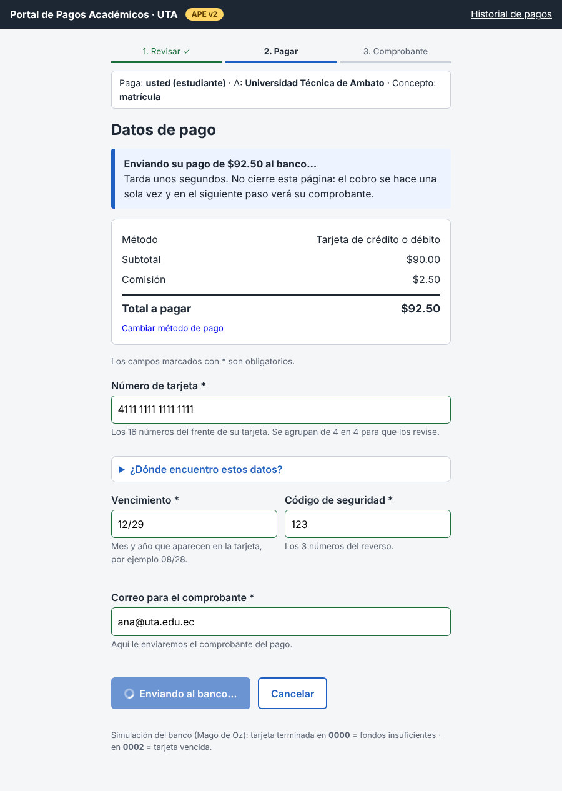
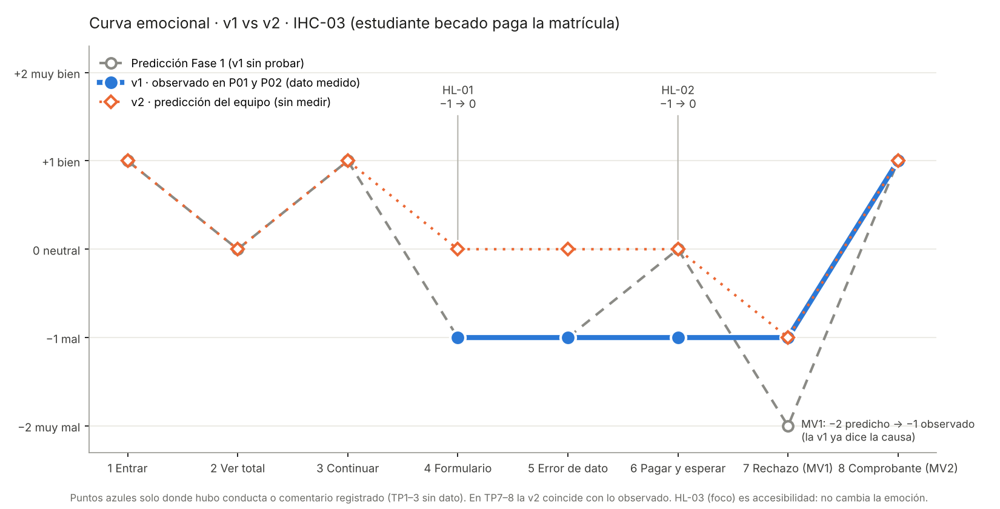

# Fase 4 · Iteración v1 → v2 · IHC-03

**Responsable:** Sheyla Pacha · Issue «F4 · v2 base, antes/después y trazabilidad»
**Entrada:** [`pruebas/hallazgos.md`](../pruebas/hallazgos.md) (P01 y P02, 05/11/2026) · **Salida:** [`prototipo/v2/`](../prototipo/v2/)
**Regla de medición:** «Medido» = salió de la prueba con P01/P02 sobre la v1. «Predicción» = lo que el equipo espera de la v2; **la v2 no se ha probado con usuarios**.

> Cómo se hizo la v2: primero se copió la v1 tal cual (commit `ddb22ff`), y después se hizo **un commit por corrección**. Así el diff de cada commit muestra solo el cambio que corrige cada hallazgo.

---

## 1. Hallazgos priorizados (≥ 3)
| Prioridad | Hallazgo | Sev. | Por qué se eligió | Issue | Responsable |
|---|---|---|---|---|---|
| 1 | **HL-03** · el foco casi no se ve | 3 | Está medido (1,83:1) y no cumple WCAG 2.4.7 / 1.4.11 | #25 | Sheyla |
| 2 | **HL-01** · ingresar la tarjeta fue lo más difícil | 2 | Lo dijeron **los dos** participantes | #23 | Martín |
| 3 | **HL-02** · duda al generar la orden de pago | 2 | Está justo antes del momento de verdad (cobro) | #24 | David |

No se corrigen: **HL-04** (beca/gratuidad: necesita datos reales de la universidad, queda como mejora futura) y **HL-05** (el rechazo ya funciona: no requiere cambio).

## 2. Tabla antes / después
| Hallazgo | Cambio realizado | Commit | Medición v1 (medido) | Medición v2 (predicción) |
|---|---|---|---|---|
| **HL-03** #25 · foco poco visible | Anillo de foco de `#ffb000` a azul oscuro `#174a96` (3 px). En la barra oscura se mantiene el amarillo. Archivo: `styles.css` | `7830c0c` | Contraste del foco **1,83:1** (blanco) y **1,69:1** (fondo) < 3:1 | **8,55:1** (blanco) · **7,91:1** (fondo) · **7,74:1** (aviso azul) · barra: **8,24:1**. *Es medición del equipo con la fórmula WCAG, no con usuarios* |
| **HL-01** #23 · no saber dónde están los datos de la tarjeta | Desplegable «¿Dónde encuentro estos datos?» bajo el número de tarjeta, con el dibujo del frente (1 número, 2 vencimiento) y el reverso (3 código de seguridad). Archivo: `pago.html` | `7898abf` | P01 y P02: «lo más difícil» fue la tarjeta · emoción **−1** en TP4–5 · T2: P01 20 s, P02 54 s | Emoción **0** en TP4–5 · T2 más corta en P02 · *predicción* |
| **HL-02** #24 · duda «cuando se generó la orden de pago» | Antes de cobrar aparece «Revise antes de pagar» con monto, medio (tarjeta •••• 1111), destinatario y correo; botones «Confirmar pago · $92.50» y «Revisar mis datos». El estado de carga dice «Enviando su pago de $92.50 al banco… Tarda unos segundos… el cobro se hace una sola vez». Archivo: `pago.html` | `5c00574` | P02 dudó en ese momento · emoción **−1** en TP6 · T3: P02 121 s (P01 20 s) | Emoción **0** en TP6 · seguridad ≥ 4/5 se mantiene · *predicción* (T3 suma un clic, pero quita la duda) |

## 3. Evidencia visual
### HL-03 · foco (arriba v1, abajo v2)

### HL-01 · ayuda para la tarjeta
| Antes (v1) | Después (v2) |
|---|---|
|  |  |

### HL-02 · confirmar antes de cobrar y estado claro
| Antes (v1): pasa directo a «Procesando» | Después (v2): «Revise antes de pagar» | Después (v2): procesando |
|---|---|---|
|  |  |  |

También con transferencia: [`05-confirmar-transferencia.png`](../evidencias/v2/05-confirmar-transferencia.png).

## 4. Curva emocional: v1 vs v2

| Touchpoint | Predicción F1 | v1 observado (P01 · P02) | Tipo | v2 esperado | Tipo | Cambio que lo explica |
|---|---|---|---|---|---|---|
| 1 Entrar | +1 | sin dato | — | +1 | predicción | — |
| 2 Ver total | 0 | sin reacción · P02 «faltaría la gratuidad» | medido (comentario) | 0 | predicción | HL-04 no se corrige |
| 3 Continuar | +1 | sin dato | — | +1 | predicción | — |
| 4 Formulario | −1 | **−1 · −1** | medido | **0** | predicción | HL-01 |
| 5 Error de dato | −1 | **−1 · −1** | medido | **0** | predicción | HL-01 (sabe qué escribir) |
| 6 Pagar y esperar | 0 | no anotado · **−1** | medido (P02) | **0** | predicción | HL-02 |
| 7 Rechazo (MV1) | −2 | **−1** · no anotado | medido (P01) | −1 | predicción | sin cambio (HL-05) |
| 8 Comprobante (MV2) | +1 | **+1 · +1** | medido (4/5) | +1 | predicción | — |

**Lectura honesta:**
- Lo único **medido** es la columna v1. La línea de la v2 es lo que el equipo espera, y solo se puede confirmar repitiendo la prueba (mismo protocolo, T1–T3) con nuevos participantes.
- El punto más bajo pasó de ser el rechazo (−2 predicho) a los datos de la tarjeta y el momento de pagar (−1 medido). Por eso se corrigen HL-01 y HL-02.
- HL-03 no mueve la curva: es una corrección de accesibilidad que sí se puede comprobar ya (contraste calculado).

## 5. Qué falta para validar la v2
- Repetir T2 y T3 con 2 participantes nuevos, midiendo tiempo, errores y la pregunta «¿dónde dudó?».
- Probar la T1 solo con teclado y anotar si el participante **ve** el foco (A1).
