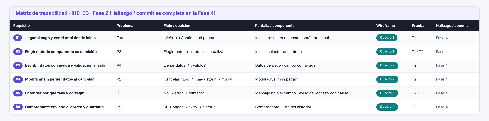

# Fase 2 · Matriz de trazabilidad · IHC-03

**Responsable:** Sheyla Pacha · Issue #14 «F2 · User flow, wireframes Lo-Fi, trazabilidad, comprobante e historial»
**Pregunta que responde:** ¿algún requisito se perdió entre el diagnóstico y la pantalla?
La columna **Hallazgo / commit** se completó en la **Fase 4** con los hallazgos de [`pruebas/hallazgos.md`](pruebas/hallazgos.md) y el commit que los corrige ([antes/después](iteracion/antes-despues.md)).

## 1. Matriz mínima de la guía
| Req. | Necesidad de usuario | Flujo / decisión | Pantalla / componente | Caso de prueba | Hallazgo / commit |
|---|---|---|---|---|---|
| R1 | Acceder al pago de la matrícula | Inicio → «Continuar al pago» | Inicio · resumen de costo · botón principal | T1 | Sin hallazgo en la prueba (P01 y P02 lo completaron) · foco: HL-03 #25 `7830c0c` |
| R2 | Elegir método comparando la comisión | Elegir método → total se actualiza | Inicio · selector de método | T1 · T2 | HL-04 (gratuidad del becado) · no se corrige en la v2 · HL-03 #25 `7830c0c` |
| R3 | Ingresar los datos de pago | Formulario → validación al salir del campo | Datos de pago · campo con ayuda y error | T2 | HL-01 #23 (los dos dudaron con la tarjeta) `7898abf` |
| R4 | Modificar sin perder datos | Cancelar / Esc → ¿hay datos? → modal | Modal «¿Salir sin pagar?» | T2 | Sin hallazgo (no se observó salida accidental) · foco del modal: HL-03 #25 |
| R5 | Corregir error | No → error → reintento (dato inválido / rechazo del banco) | Mensaje bajo el campo · aviso de rechazo con causa | T2-E | Primer arreglo de P1: `3701ee9` (en `prototipo/base-prueba/pago.html`) · HL-05: P01 se recuperó solo, sin cambio · HL-02 #24 `5c00574` |
| R6 | Finalizar con confirmación | Sí → pagar → éxito → historial | Comprobante · lista del historial | T3 | HL-02 #24 (duda al generar la orden) `5c00574` |

## 2. Requisito → artefactos
Issues de origen: P1 #1 · P2 #2 · P3 #3 · P4 #4 · P5 #5.

| Req. | Problema | Sitemap | Navegación | User flow | Componentes | Wireframe | Prototipo v1 |
|---|---|---|---|---|---|---|---|
| R1 | Tarea | 1.0 Pagar matrícula | Nav. 1 | Paso 1 | Resumen de costo · botón «Continuar» | `01-inicio` | `inicio.html` |
| R2 | P3 | 1.0 Pagar matrícula | Nav. 1 | Paso 2 | Selector de método | `01-inicio` | `inicio.html` |
| R3 | P4 | 2.0 Datos de pago | Nav. 2 | Pasos 3–4 | Campo con ayuda y error | `02-formulario` | `pago.html` |
| R4 | P2 | 2.3 ¿Salir sin pagar? | Nav. 5 | Rama «Cancelar / Esc» | Modal · botón «Cancelar» | `02-formulario` | `pago.html` |
| R5 | P1 | 2.2 Rechazo con causa | Nav. 2 y 4 | Pasos 4 y 6 · ramas «No» | Aviso de estado · mensaje bajo el campo | `03-error` | `pago.html` |
| R6 | P5 | 3.0 Comprobante · 4.0 Historial | Nav. 3, 6 y 7 | Pasos 7–8 | Comprobante · lista del historial | `04-exito` | `confirmacion.html`, `historial.html` |

## 3. Prueba de fuego
- [x] Ningún requisito queda sin pantalla, flujo, componente y wireframe.
- [x] Cada problema P1–P5 del diagnóstico tiene un requisito que lo atiende.
- [x] Todo wireframe corresponde al menos a un requisito.
- [x] Los nombres son iguales en sitemap, botones y títulos («Pagar matrícula», «Datos de pago», «Comprobante», «Historial de pagos»).
- [x] Hallazgo / commit → completado en la Fase 4.

## 4. Hallazgo → requisito → commit (Fase 4)
| Hallazgo | Sev. | Requisitos | Issue | Archivo de la v2 | Commit |
|---|---|---|---|---|---|
| HL-01 Datos de la tarjeta | 2 | R3 | #23 | `prototipo/v2/pago.html` | `7898abf` |
| HL-02 Duda al generar la orden | 2 | R5 · R6 | #24 | `prototipo/v2/pago.html` | `5c00574` |
| HL-03 Foco poco visible | 3 | R1–R6 (todas las pantallas) | #25 | `prototipo/v2/styles.css` | `7830c0c` |
| HL-04 Gratuidad del becado | 2 | R2 | — | no se corrige (mejora futura) | — |
| HL-05 Rechazo del banco | 1 | R5 | — | no requiere cambio | — |
