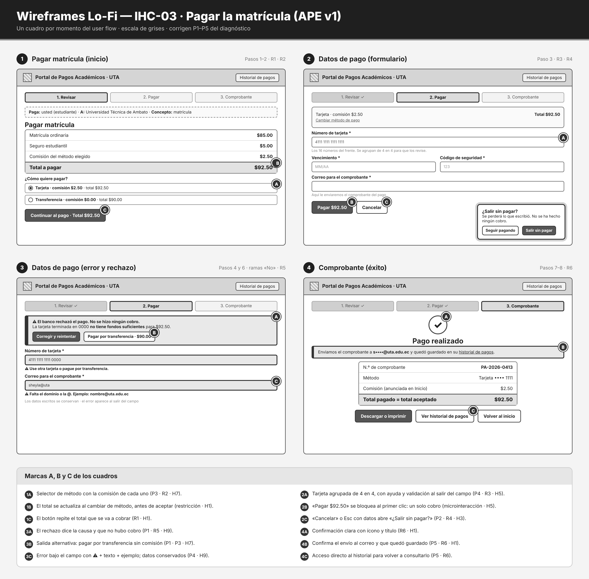

# Fase 2 · Wireframes Lo-Fi · IHC-03

**Responsable:** Sheyla Pacha · Issue #14
Baja fidelidad: **solo escala de grises**, sin colores ni imágenes reales. Un cuadro por momento del user flow. Las marcas A, B y C explican qué problema del diagnóstico corrige cada detalle.

| Archivo | Pantalla | User flow | Requisitos | Corrige |
|---|---|---|---|---|
| [`01-inicio.png`](01-inicio.png) | Pagar matrícula (inicio) | Pasos 1–2 | R1 · R2 | P3 |
| [`02-formulario.png`](02-formulario.png) | Datos de pago + modal «¿Salir sin pagar?» | Paso 3 | R3 · R4 | P2 · P4 |
| [`03-error.png`](03-error.png) | Datos de pago con error y rechazo | Pasos 4 y 6 · ramas «No» | R5 | P1 · P4 |
| [`04-exito.png`](04-exito.png) | Comprobante | Pasos 7–8 | R6 | P5 |

## Del wireframe al prototipo
Cada cuadro tiene su pantalla en `prototipo/v1/` (`inicio.html`, `pago.html`, `confirmacion.html`, `historial.html`). Las capturas del prototipo en funcionamiento están en `evidencias/v1/`.
